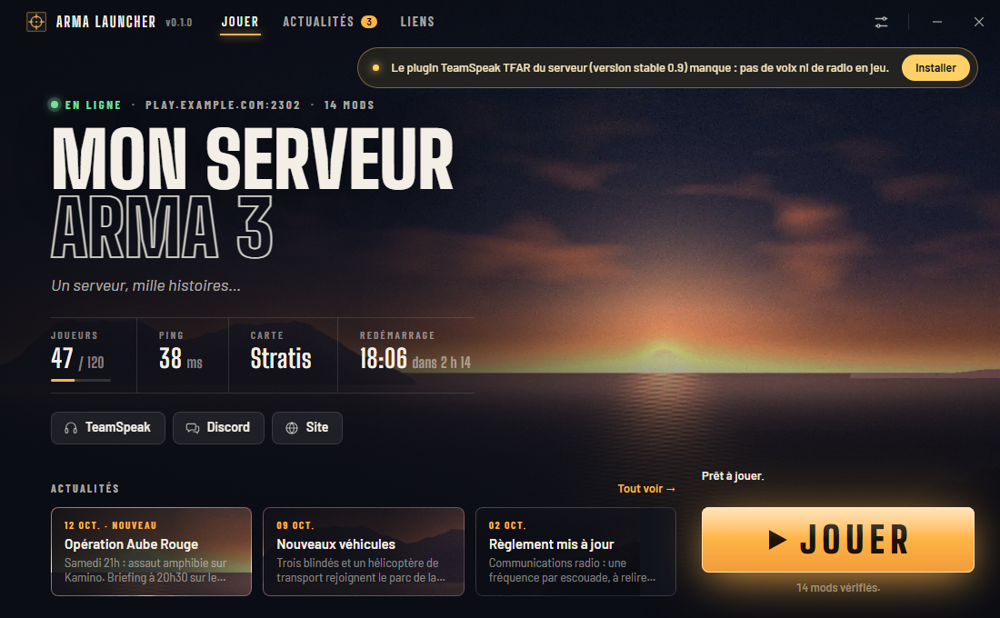
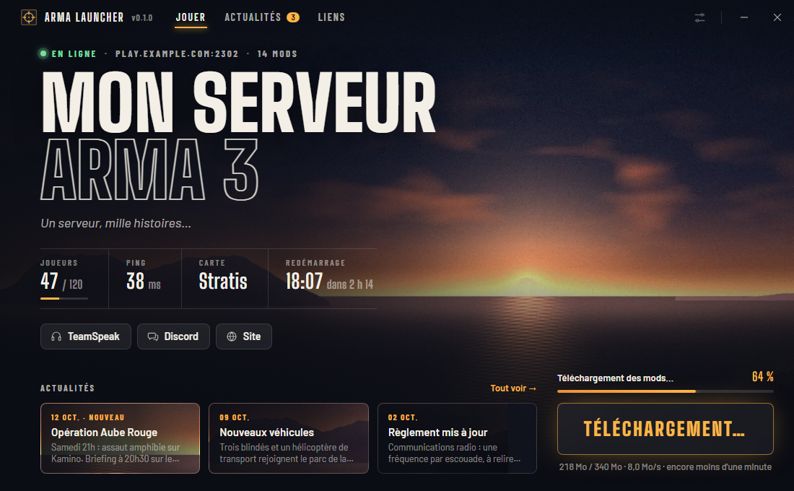
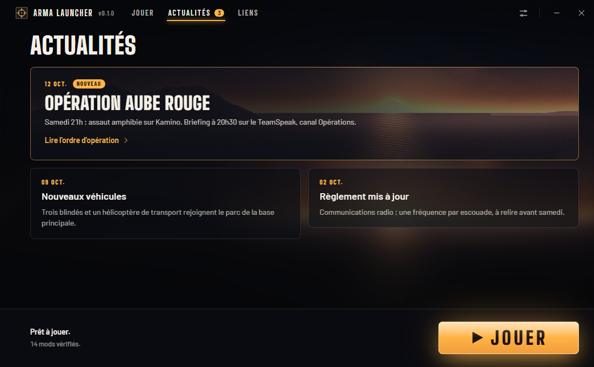
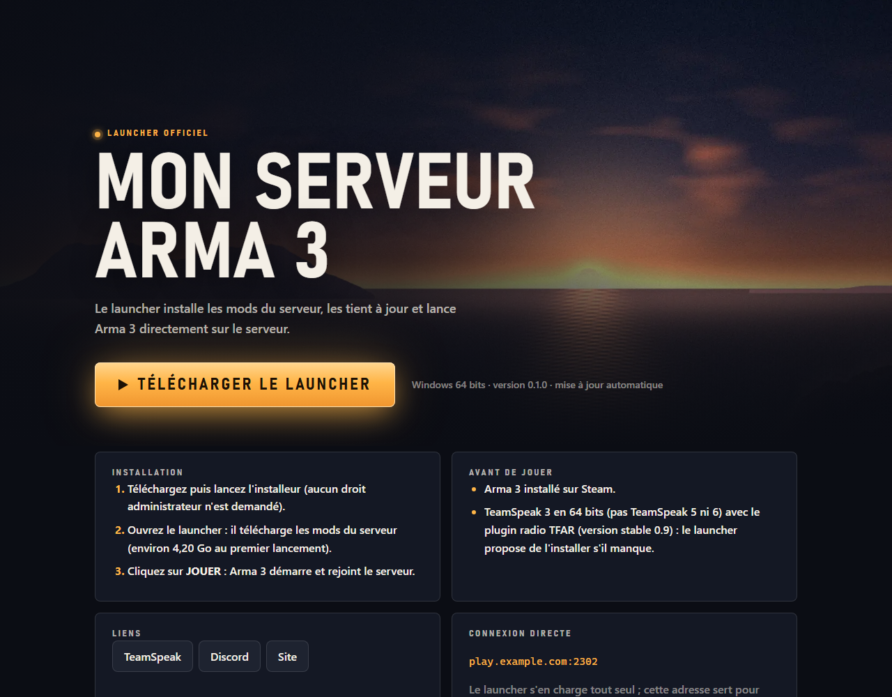

# Arma Launcher

Un launcher Windows pour **votre** serveur Arma 3, et le serveur de mises à jour qui va avec.

Le joueur installe le launcher une fois. Ensuite, à chaque ouverture, il :

- télécharge seulement les fichiers de mods qui ont changé (vérifiés par SHA-256) ;
- lance Arma 3 avec BattlEye, les bons mods et la connexion directe au serveur (mot de passe compris) ;
- affiche l'état du serveur (joueurs connectés, carte), vos actualités et vos liens (Discord, TeamSpeak, site) ;
- vérifie et propose le plugin TeamSpeak TFAR, version stable 0.9 ou bêta 1.0 (option à activer côté serveur) ;
- se met à jour tout seul quand vous publiez une nouvelle version.



| Synchronisation des mods | Actualités | Page de téléchargement |
|---|---|---|
|  |  |  |

Côté serveur, **aucun code ne tourne** : nginx sert des fichiers statiques, et un petit outil Python (dans Docker lui aussi) prépare ces fichiers à partir de votre dossier de mods.

## Principe

```
 Votre PC (Windows)                       Votre VPS (Docker)                        PC des joueurs
 ──────────────────                       ──────────────────                        ──────────────
 launcher.config.json                     serveur/
   nom, URL, couleurs, clé publique         mods/@CBA_A3 @MonMod …   (vos mods)
        │                                   config/launcher.json     (news, liens)
        ▼                                   launcher-build/          (installeur signé)
 npm run tauri build ──── copie ─────────►        │
   installeur .exe + .sig                         ▼  docker compose run --rm publier
                                            donnees/                                  Launcher
                                              launcher.json  manifest.json   ◄─HTTPS──  lit la config,
                                              mods/…  tfar/…  index.html                compare, télécharge
                                              update/latest.json + .exe                 le delta, lance Arma 3
                                                  ▲
                                            nginx (docker compose up -d)
```

## Démarrage rapide

Il faut un PC Windows (pour construire le launcher) et un VPS Linux avec Docker et un nom de domaine qui pointe dessus.

1. **Sur le PC** : installez [Node.js](https://nodejs.org) (LTS) et [Rust](https://rustup.rs) avec les [prérequis Tauri](https://tauri.app/start/prerequisites/), puis éditez `launcher.config.json` : au minimum `nom`, `identifiant` et `urlServeur` (l'adresse de votre serveur, par exemple `https://play.mon-serveur.fr`), et si vous voulez `couleurs.accent` et `imageFond` (image de fond). Détails : [docs/02-personnaliser-le-launcher.md](docs/02-personnaliser-le-launcher.md).
2. **Facultatif, pour la mise à jour automatique du launcher** : créez une clé de signature dans `cles/launcher.key` et collez la clé publique dans `clePubliqueMaj` ([docs/03-signer-et-construire.md](docs/03-signer-et-construire.md)). Sans clé, tout fonctionne, mais les joueurs devront retélécharger le launcher à chaque nouvelle version.
3. **Double-cliquez sur `preparer.bat`.** Il vérifie les outils et la configuration, construit et signe l'installeur, puis assemble `a-envoyer/` et `a-envoyer.zip` : la partie serveur (Docker, nginx, outil `publier`), `.env` prérempli, `config/launcher.json`, un dossier `mods/` vide et l'installeur dans `launcher-build/`.
4. **Sur le VPS** : envoyez le dossier (WinSCP ou `scp -r a-envoyer utilisateur@vps:arma-launcher`), puis suivez `a-envoyer/LISEZMOI.txt` :
   ```sh
   cd arma-launcher
   nano .env                                  # EMAIL_ACME ; URL_PUBLIQUE et DOMAINE sont préremplis
   nano config/launcher.json                  # nom, adresse et port de jeu, liens, news, tfar
   # déposer les dossiers @Mod dans mods/
   docker compose --profile https up -d       # nginx + HTTPS automatique (Caddy)
   docker compose run --rm publier --a-sec    # simulation
   docker compose run --rm publier            # publication
   ```
   La page `https://votre-domaine/` propose alors le launcher en téléchargement. Détails : [docs/01-installer-le-serveur.md](docs/01-installer-le-serveur.md).
5. **Ensuite** : de nouveaux mods, news ou liens se publient sur le VPS seul (`docker compose run --rm publier`) ; une nouvelle version du launcher demande de relancer `preparer.bat` et de renvoyer seulement `launcher-build/`. Voir [docs/04-publier-une-mise-a-jour.md](docs/04-publier-une-mise-a-jour.md).

Vous préférez tout faire à la main (cloner le dépôt sur le VPS, `npm run tauri build`) ? Les docs 01 à 04 décrivent chaque étape sans `preparer.bat`.

## Documentation

| Fichier | Contenu |
|---|---|
| [01-installer-le-serveur.md](docs/01-installer-le-serveur.md) | VPS, Docker, DNS, HTTPS (profil Caddy, reverse proxy existant, certbot) |
| [02-personnaliser-le-launcher.md](docs/02-personnaliser-le-launcher.md) | `launcher.config.json`, logo, icônes, image de fond, couleurs |
| [03-signer-et-construire.md](docs/03-signer-et-construire.md) | Clé de mise à jour, construction, signature manuelle |
| [04-publier-une-mise-a-jour.md](docs/04-publier-une-mise-a-jour.md) | Mods, news, nouvelle version du launcher |
| [05-format-des-fichiers.md](docs/05-format-des-fichiers.md) | `launcher.json`, `manifest.json`, `latest.json`, règles de validation |
| [06-depannage.md](docs/06-depannage.md) | Problèmes courants |

## Arborescence

```
launcher.config.json     LE fichier à éditer pour personnaliser le launcher
preparer.bat             construit le launcher et prépare a-envoyer/ (+ .zip) pour le VPS (outils/preparer.ps1)
launcher/                application Tauri 2 (Rust + TypeScript/Vite)
  scripts/configurer.mjs   reporte launcher.config.json dans tauri.conf.json, package.json, Cargo.toml
  scripts/visuels.py       génère des visuels neutres (Pillow)
  src-tauri/               backend Rust (synchronisation, lancement, A2S, TFAR…)
  src/                     interface
serveur/                 serveur de mises à jour (Docker)
  docker-compose.yml       nginx, outil « publier », profil « https » (Caddy)
  nginx/                   configuration nginx
  publier/                 outil de publication (Python, sans dépendance)
  config/                  launcher.json (à créer depuis launcher.exemple.json)
docs/                    documentation
```

## Prérequis

- Serveur : Linux avec Docker Engine et le plugin Compose (`docker compose`).
- Construction du launcher : Windows 10/11, [Node.js](https://nodejs.org) 20 ou plus, [Rust](https://rustup.rs) stable (MSVC), les [prérequis Tauri](https://tauri.app/start/prerequisites/) (WebView2 est déjà présent sur Windows 10/11 à jour).
- Joueurs : Windows 10/11 64 bits, Arma 3 sur Steam.

## Licence

[MIT](LICENSE). Voir aussi [CONTRIBUTING.md](CONTRIBUTING.md).
